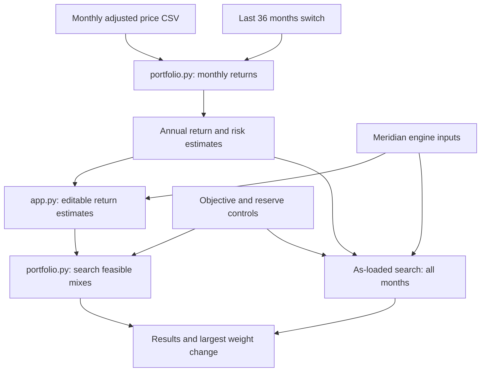

# Lab 15 — Portfolio Stability Decision
Linda Li · FIN 43900 · October 22, 2026

Which mix carries the least risk while meeting the mandate, and does the answer survive a one-point change in one estimate?

## Run
```bash
python -m pip install -r requirements.txt
python portfolio.py
python -m streamlit run app.py
```

The engine extends [my Lab 14 portfolio.py](https://github.com/llindali/lab14/blob/main/portfolio.py); its baseline printed output is unchanged. The app imports the engine's inputs, search and estimation functions. All allocations are fully invested and long-only, searched in 5-percentage-point steps. Return and reserve requirements filter candidates; the lowest-volatility feasible candidate wins. This is the minimum on that grid, not a continuous optimum. Equal-volatility ties retain the first mix enumerated. An infeasible target displays `no mix meets the objective`.

## Meridian validation — executed
Training inputs, not market forecasts. Objective 6.5%; reserve minimum 3%; bills and the 10-year note qualify.

| Run | Bills / 10-year / IG / equity (%) | Return estimate | Volatility | Reserve |
|---|---|---:|---:|---:|
| As loaded | 0 / 20 / 25 / 55 | 6.51% | 9.44% | 20.00% |
| Equity estimate 8% → 7% | 0 / 10 / 10 / 80 | 6.53% | 12.94% | 10.00% |
| IG–equity correlation 0.25 → 0.50, both cells | 0 / 40 / 0 / 60 | 6.52% | 9.73% | 40.00% |

Largest weight change under the equity stress: **25 percentage points**, from 55% to 80% equity. The correlation probe was computed using a modified copy; saved engine inputs remain 0.25. The app's default and equity-stress paths were executed using Streamlit's AppTest and matched the engine. A 9% objective correctly returned no feasible mix. Full-window and last-36-month CSV estimates were checked against direct monthly-return calculations with temporary synthetic test inputs; those test inputs are not submitted as market data.

Estimation risk arises because inputs are uncertain. When the equity estimate falls, the return constraint requires more equity to reach the same target, despite its greater volatility. A one-point input change therefore reallocates a quarter of the portfolio and raises risk materially.

## App and engine flow


The last-36 switch selects the last 36 monthly returns after computing returns from prices. Annual estimates use monthly mean × 12, sample standard deviation × √12 and monthly correlations. The original comparison always uses all uploaded months under the same objective and reserve selections. Changing the window resets editable estimates to that window's values. Prices must be positive, complete, consecutive monthly observations with date first and 3–6 ticker columns. At least 61 prices supply 60 monthly returns. Historical means are estimates, not forecasts; annual scaling assumes independent months. Select **Apex project** in the sidebar to load the committed prices with the 7% target and 0.25% annual cost assumption; Meridian remains the default training mode. The cost control applies equally to both comparison runs.

## Project 2 — Apex mandate and chosen assumptions
Client: Apex University Student Investment Fund Endowment Reserve, fictional; $50 million initial assets. The original [Lab 13 mandate](https://github.com/llindali/lab13/blob/main/lab13.md) targets CPI + 4.5% net of fees over rolling ten-year periods and requires a $1.5 million cash/Treasury buffer.

For this lab I choose **2.5% planning inflation**, giving a **7.0% net return objective**, and **0.25% annual operating/custody costs**. These are explicit modeling assumptions, not observed CPI or a quoted fee schedule. Each historical return estimate is reduced by 0.25 percentage point before searching. Fund-level expenses are already reflected in adjusted-price performance and are not deducted twice. The return target stays 7% in every run; no target is lowered to force feasibility. A historical arithmetic estimate exceeding 7% does not prove the ten-year net-return objective will be achieved.

| Fund | Role | Reserve eligible? | Fund description |
|---|---|---|---|
| SGOV | Short Treasury reserve | Yes | [iShares 0–3 Month Treasury Bond ETF](https://www.ishares.com/us/products/314116/ishares-0-3-month-treasury-bond-etf) |
| BND | Broad U.S. investment-grade bonds | No | [Vanguard Total Bond Market ETF](https://advisors.vanguard.com/investments/products/bnd/vanguard-total-bond-market-etf) |
| VT | Global equities | No | [Vanguard Total World Stock ETF](https://advisors.vanguard.com/investments/products/vt/vanguard-total-world-stock-etf) |

Hard constraint modeled: **at least 3% in SGOV**, plus fully invested, long-only weights. With 5-point search steps, the smallest positive reserve is 5%. For the learning mandate, I choose to exempt U.S. Treasury exposure and diversified fund vehicles from the direct corporate-issuer 5% cap; direct holdings of any other corporate issuer would be aggregated across debt and equity. There are no direct corporate securities in this fund universe. This explicitly selected interpretation is not a representation that the client approved it and is not a look-through concentration check. Adoption requires client confirmation or a holdings-based look-through test. The 70% MSCI World / 30% Bloomberg Aggregate benchmark remains the mandate's performance reference; VT is a broader global-stock exposure, not an exact MSCI World replica. No unapproved tracking-error cap is added.

## Prices and sources
Downloaded **October 22, 2026**, from Yahoo Finance's chart endpoint using the `Adj Close` field on daily observations, then taking the final available trading observation in each calendar month. Dates in `prices.csv` label calendar month-end. All funds are USD. There are **61 monthly prices, September 2021–September 2026**, supplying **60 returns, October 2021–September 2026**. October 2026 is excluded as incomplete. The last-36-month run uses **October 2023–September 2026 returns** and their September 2023 starting price. No missing months, forward fills or fabricated prices.

| Ticker | Historical-price source | Download date |
|---|---|---|
| SGOV | [Yahoo Finance adjusted daily series](https://query1.finance.yahoo.com/v8/finance/chart/SGOV?period1=1630454400&period2=1790812800&interval=1d&events=div%2Csplits) | 2026-10-22 |
| BND | [Yahoo Finance adjusted daily series](https://query1.finance.yahoo.com/v8/finance/chart/BND?period1=1630454400&period2=1790812800&interval=1d&events=div%2Csplits) | 2026-10-22 |
| VT | [Yahoo Finance adjusted daily series](https://query1.finance.yahoo.com/v8/finance/chart/VT?period1=1630454400&period2=1790812800&interval=1d&events=div%2Csplits) | 2026-10-22 |

These are vendor-adjusted prices as downloaded on that date, not an archived point-in-time vintage. Future vendor revisions may change the series. All calculations below use the committed `prices.csv`.

## Estimates and stability — calculated from prices.csv
All returns below are annual arithmetic **estimates**, not forecasts. Net estimates deduct the chosen operating/custody cost.

| Fund | 60-month net return estimate | 60-month volatility | 36-month net return estimate | 36-month volatility |
|---|---:|---:|---:|---:|
| SGOV | 3.47% | 0.50% | 4.19% | 0.21% |
| BND | −0.67% | 6.45% | 3.85% | 5.50% |
| VT | 11.65% | 14.92% | 20.00% | 11.71% |

| Run | SGOV / BND / VT (%) | Net return estimate | Volatility | Reserve weight | Reserve value at initial $50M |
|---|---|---:|---:|---:|---:|
| All 60 months | 55 / 0 / 45 | 7.15% | 6.77% | 55.00% | $27.5M |
| Last 36 months | 80 / 0 / 20 | 7.35% | 2.37% | 80.00% | $40.0M |
| All months; VT estimate reduced by 1 point | 50 / 0 / 50 | 7.06% | 7.51% | 50.00% | $25.0M |

Both window allocations sum to 100%, contain no negative weights, meet the unchanged 7% estimated net-return objective and exceed the $1.5M buffer. Direct non-exempt corporate holdings are zero under the selected cap interpretation. These tests do not establish future performance, look-through concentration or client approval.

**Largest window-driven weight change: 25 percentage points** (SGOV 55% → 80%, VT 45% → 20%). BND receives zero weight in both windows; for these estimates, SGOV offers a higher mean and much lower standalone volatility, and the exhaustive grid search finds no bond-containing mix with lower volatility at the target. The recent equity estimate is much higher, so less equity is needed to clear 7%; that does not make the recent estimate more credible. The one-point VT stress shifts **5 points** into equity and raises volatility from 6.77% to 7.51%. All searches use unrounded estimates.

### Additional AI stress — not a partner interaction
I reduced the all-month VT net estimate from 11.6452% to 10.6452%, which shifted the allocation from 55% SGOV / 45% VT to 50% SGOV / 50% VT while preserving the 7% target. The larger 25-point window sensitivity shows that my starting allocation depends materially on the estimation period, even though the one-point stress moves only 5 points.

The actual partner attack and its two-sentence response will be added after class; the AI stress above does not substitute for that required interaction.

## Project 2 call
**Pilot the all-month mix as the Project 2 starting allocation**, rather than adopt it for real assets: changing the estimation window reallocates 25 points and the recent VT return estimate is unusually strong relative to the full window. I would reconsider adoption only if independently justified forward-looking estimates and alternative windows/stresses keep the largest allocation shift within a chosen 10-point tolerance, while the net target and reserve remain satisfied, and the client confirms the fee and issuer-cap assumptions. Otherwise I would reject this optimizer output as an implementation allocation and revise the estimation approach without lowering the mandate objective.

## Submission files
- [Written work](README.md)
- [Risk engine](portfolio.py)
- [Streamlit app](app.py)
- [Monthly adjusted prices](prices.csv)
- [Dependencies](requirements.txt)

Source: [Lab 15 instructions](https://github.com/CinderZhang/FIN43900-Fall2026/blob/main/lessons/week-09/lab-15-portfolio-stability.md). AI assisted implementation, validation and written analysis. Class activities are performed in class; no partner interaction is claimed here.
