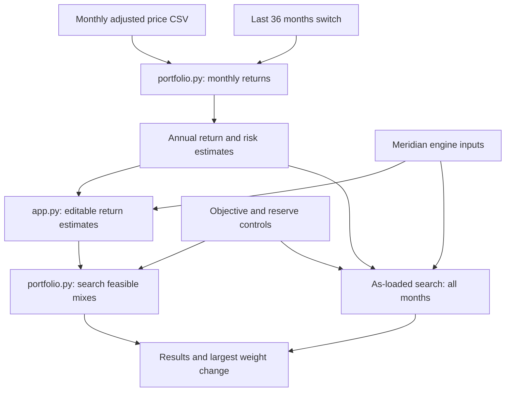

# Lab 15 — Portfolio Stability Decision
Linda Li · FIN 43900 · October 22, 2026

Which mix carries the least risk while meeting the mandate, and does the answer survive a one-point change in one estimate?

## Run
```bash
python -m pip install -r requirements.txt
python portfolio.py
python -m streamlit run app.py
```

The engine extends [my Lab 14 portfolio.py](https://github.com/llindali/lab14/blob/main/portfolio.py); its baseline printed output is unchanged. The app imports the engine's inputs, search and estimation functions. All allocations are fully invested and long-only, searched in 5-percentage-point steps. Return and reserve requirements filter candidates; the lowest-volatility feasible candidate wins. This is the minimum on that grid, not a continuous optimum. Equal-volatility ties retain the first mix enumerated. An infeasible target displays `no mix meets the objective`.

## Meridian validation — executed
Training inputs, not market forecasts. Objective 6.5%; reserve minimum 3%; bills and the 10-year note qualify.

| Run | Bills / 10-year / IG / equity (%) | Return estimate | Volatility | Reserve |
|---|---|---:|---:|---:|
| As loaded | 0 / 20 / 25 / 55 | 6.51% | 9.44% | 20.00% |
| Equity estimate 8% → 7% | 0 / 10 / 10 / 80 | 6.53% | 12.94% | 10.00% |
| IG–equity correlation 0.25 → 0.50, both cells | 0 / 40 / 0 / 60 | 6.52% | 9.73% | 40.00% |

Largest weight change under the equity stress: **25 percentage points**, from 55% to 80% equity. The correlation probe was computed using a modified copy; saved engine inputs remain 0.25. The app's default and equity-stress paths were executed using Streamlit's AppTest and matched the engine. A 9% objective correctly returned no feasible mix. Full-window and last-36-month CSV estimates were checked against direct monthly-return calculations with temporary synthetic test inputs; those test inputs are not submitted as market data.

Estimation risk arises because inputs are uncertain. When the equity estimate falls, the return constraint requires more equity to reach the same target, despite its greater volatility. A one-point input change therefore reallocates a quarter of the portfolio and raises risk materially.

## App and engine flow


The last-36 switch selects the last 36 monthly returns after computing returns from prices. Annual estimates use monthly mean × 12, sample standard deviation × √12 and monthly correlations. The original comparison always uses all uploaded months under the same objective and reserve selections. Changing the window resets editable estimates to that window's values. Prices must be positive, complete, consecutive monthly observations with date first and 3–6 ticker columns. At least 61 prices supply 60 monthly returns. Historical means are estimates, not forecasts; annual scaling assumes independent months.

## Project 2 mandate and required results — pending inputs
The [Lab 13 mandate](https://github.com/llindali/lab13/blob/main/lab13.md) names Apex University Student Investment Fund Endowment Reserve, initial assets $50 million. Objective: CPI + 4.5% net of fees over rolling ten-year periods. Cash/Treasury buffer: $1.5 million, or 3% of initial assets. The numeric CPI assumption, fee adjustment, 3–6 funds and adjusted-price history have not been supplied. No market prices or personal-universe results are invented.

Required to finish this section: each ticker's source and download date; numeric net-return objective and reserve-eligible funds; all-month allocation, return, volatility and reserve; last-36-month equivalents; largest weight change (or honest infeasibility); the actual partner attack and two-sentence response; and a Project 2 adopt/pilot/reject call with a condition tied to the stress results.

The app tests long-only, return and reserve conditions. Apex's separate 5% issuer constraint still needs issuer aggregation, exemptions and fund look-through treatment clarified before overall mandate compliance can be established. Uploaded historical total returns are gross of operational/custodial costs unless the editable return estimates are adjusted for those costs.

## Training call
**Pilot** the Meridian mix: a one-point reduction in the equity estimate moves 25 points into equity and raises volatility from 9.44% to 12.94%. Adoption would require defensible return estimates, acceptable stability across windows and stresses, and clarification of the client's loss rule. This training call does not substitute for the pending Apex decision.

## Submission files
- [Written work](README.md)
- [Risk engine](portfolio.py)
- [Streamlit app](app.py)
- [Dependencies](requirements.txt)

Source: [Lab 15 instructions](https://github.com/CinderZhang/FIN43900-Fall2026/blob/main/lessons/week-09/lab-15-portfolio-stability.md). AI assisted implementation, validation and written analysis. Class activities are performed in class; no partner interaction is claimed here.
